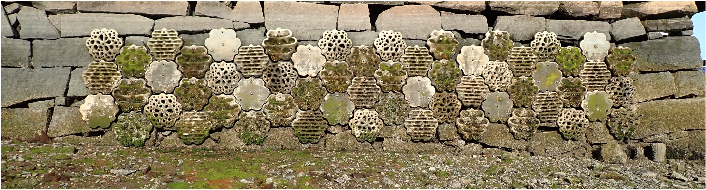
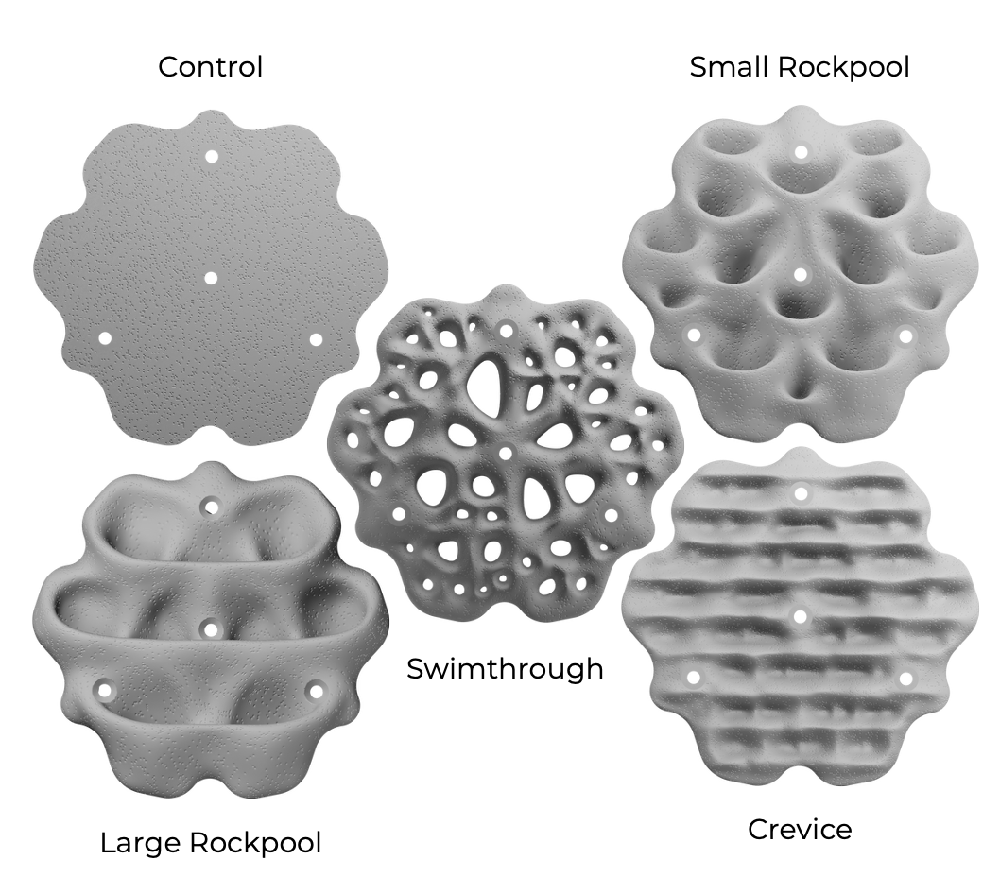
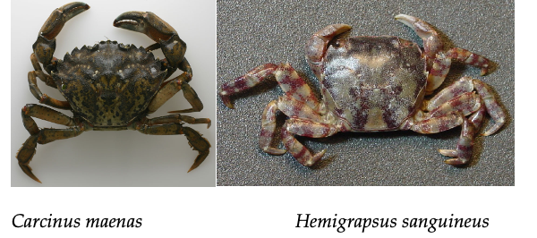
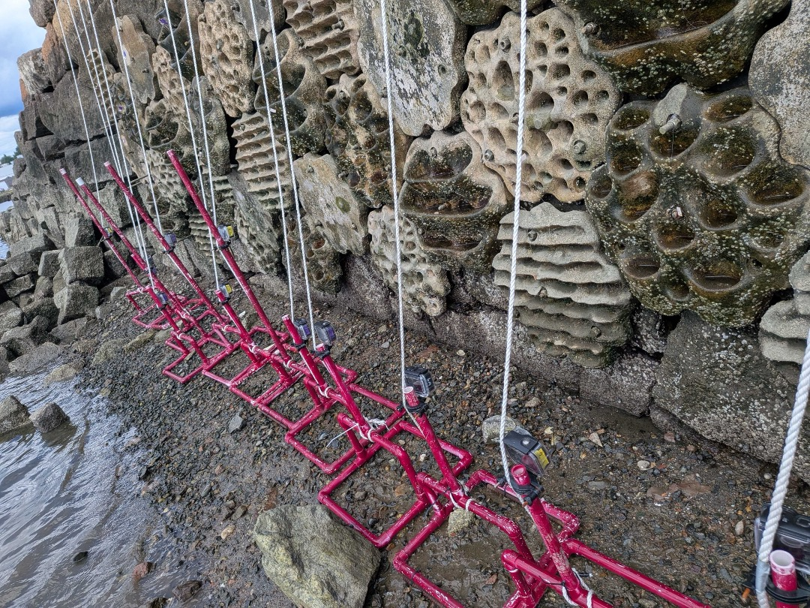

<!-- notes Consider writing times on paper first then transfer to sheet

Column for tracking the same crab?

Add east

tally unique crabs alongside behaviors

note total time

note that if they do the same behavior separate times, note each one - i.e. moving from shelter to shelter

If a crab is invisible sheltering, just record the first behavior you see

record interaction end times?

-->

## ⚓️ Introduction

For the past few years, the [Stone Living Lab](https://stonelivinglab.org) has had [Living Seawalls](https://stonelivinglab.org/living-seawalls/) up in the Seaport and in East Boston. These seawalls are composed of hexagonal panels with different feature types - flat controls, ridged crevices, hole-filled swim throughs, bumpy small rockpools, and deep large rockpools. We want to know, how do coastal organisms use these different panel types

One particular organism we want to target is crabs. What species of crabs use different panels? How do different panel types alter crab behavior? Does panel type affect energy flow - i.e. how quickly crabs eat a targeted piece of food? To answer this we are going to target two species of crabs - the Asian Shore crab *Hemigrapsus sanguineus* and the Green Crab, *Carcinus maenas*.

Over the summer of 2026, the SLL REU Destiny Ruiz-Sanchez secured pieces of squid bait onto a row of panels at the lower end of the East Boston Living Seawall at [Condor Street Urban Wild](https://search.boston.gov/departments/parks-and-recreation/project/condor-urban-wild-project). Then, she placed cameras in front of them to turn on as the tide came in. We have about an hour of footage for each panel, and we want you to quantify crab behaviors during that time.

## 🧪 Methods

Our goal is to fill out [this sheet](https://docs.google.com/spreadsheets/d/18MQeGc09VgxqoSyjqJfSwL7b_7sKQgguKKDWktyLG3A/edit?usp=sharing) with data - I will aggregate it into something to analyze for your writeups. You might want to grab your own copy of the sheet - put it in excel or somesuch - and paste back for ease of use later.

Videos can be found [here](https://www.dropbox.com/scl/fo/1gqqiuqsgd9a15ldnit2n/AFaJfnLfN0G1Fwxx8YgwgME?rlkey=wyfh0q2ssetkodbxtcr1nsks9&dl=0).

1. Signup for a panel! Download the folder with that panel's videos.

2. Use the information in the video name to fill out a row on the annotation sheet. Make sure you record panel type. Please space yourselves out generously across the sheet.

3. Start watching videos! Make a note of time 0 when you first see the panel totally covered by water. Watch until you see a crab. When you first observe a crab, note it's species, presence and a time stamp in the annotation sheet. Note: If you have more than one crab, record each on a separate line at the same time stamp.

4. Continue watching the crabs, and record each behavior it engages in from the following list as well as its time stamp. If multiple crabs are engaged in a behavior, record it for each.

* **Passing**: Crabs scurrying on the panel without pausing. 

* **Shelter use**: Crabs using the panels for an extended period. (Crawling inside a tight space and staying there, cleaning the shelter space, using it for shelter) 

* **Foraging**: Looking for and consuming food on the panels. 

* **Presence**: Staying on the panel for a period of time not using for shelter. (Not inside crevice, not inside the pools, not inside swim through holes) 

* **Predation**: Attacking and consuming bait we placed (squidpops) 

* **Interaction**:	Crab and another crab *of the same species* touching, fighting, displacing, chasing, competing over bait/ shelter.  

* **Interaction(Fish)**:	Crab and fish touching, fighting, displacing, chasing, competing over bait/ shelter.  

* **Interaction(HESA/CAMA)**:	Interaction between crab and a *different species of crab*, fighting, displacing, chasing, competing over bait/ shelter.

6. Be careful and do not count crabs twice even if they stay in an area for a prolonged period of time. 

7. When one video ends, start the next. Continue until you have gone through 60 minutes of video. If your videos end early and you have only 45, that's OK.

## 💻 Writeup Your Lab Report!

I will process the data into a format showing you number of crabs, frequency of interactions, and more.

Please use Jamovi for all stats and graphs (or an alternate figure-making software, if you choose). We want to move writeups to a scientific-paper style. So, please provide:

1)	A brief introduction to what you observed. Discuss your hypothesis from before you started working on this project about how panel types will influence crab behavior and why. 
  
2)	Give a short writeup of what we as a class did.
  
3)	Break down the results for crab behaviors by panel type. Then write a narrative discussion about what this could mean with respect to how different panels could influence the crab fauna of Boston Harbor.
  
4)	End with a conclusion regarding the weight of evidence for or against your initial hypothesis.

