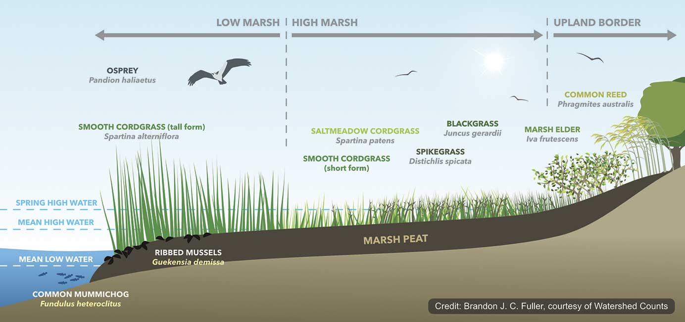
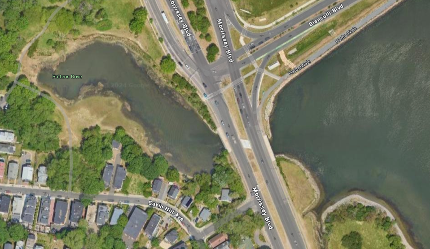
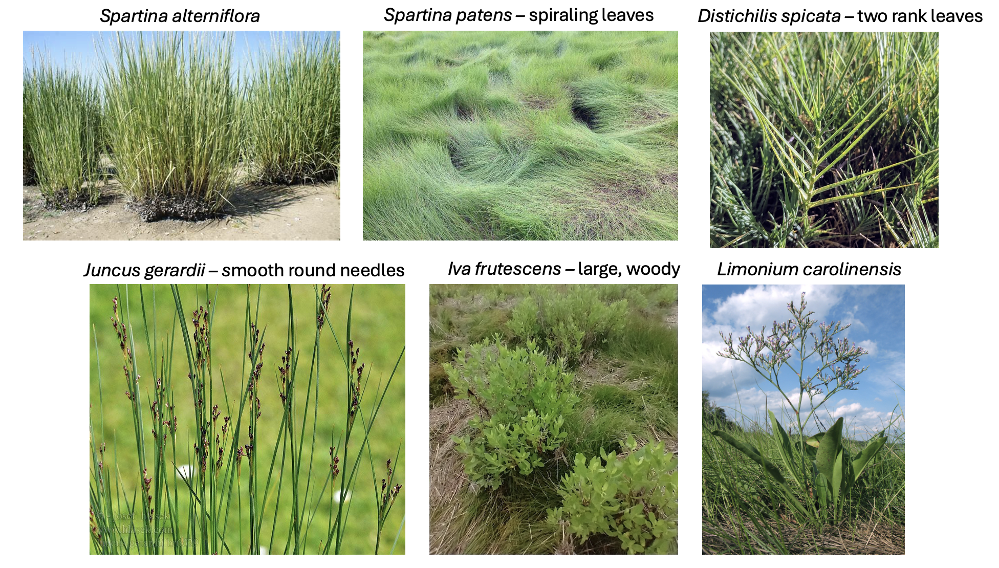
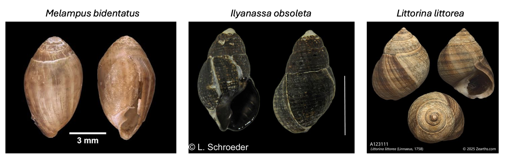
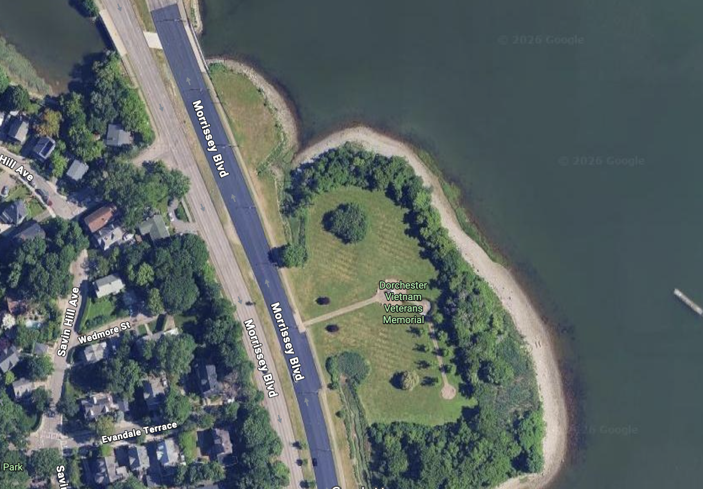

## ⚓️ Introduction
In this lab we will be exploring salt marsh plant ecology in salt marshes near campus.   Salt marshes of New England have a striking pattern of plant zonation, where the lower border of marsh plant zones are set by physical stress (salinity/distance from creek) and the upper border of these zones are set by competition.  We are going to examine where this zonation holds true and where it does not! 

  

## 🧪 Methods

### Part 1. Patens Cove

  
Pattens Cove Marsh represents a compressed, but typical, New England marsh.  The low marsh *Spartina alterniflora* zone is flooded by every high tide.  Behind this zone is the high marsh, dominated by a small *Spartina patens* meadow; this zone is flooded by the higher than average tides.  Finally, the back edge of the high marsh has a variety of plants that are flooded at spring tides only.  We are going to characterize this marsh by measuring the size of these zones, the species diversity, and differences in elevation between zones.  We will pay special attention to the *S. alterniflora* zone of a marsh, which is especially important in marsh processes because it is the most productive, traps the most sediment and provides the most habitat.

In groups of three, spreading out so there are equal numbers of groups on each side of the marsh. Each group should run 3 transects and record the following: 

1)	Describe the patterns in marsh plant zonation using a line transect with 8 quadrats evenly spaced from the creek bank to the terrestrial border of the marsh.  Minimum data to collect in each plot: number of species, percent cover of each species and bare mud, number of snails - either *Littorina* or *Melampus*.

  
  

2)	While in the *Spartina alterniflora* zone and in any plot where it is present, take data on *Spartina* plant quality.  Record live (green) and dead (brown) stem density in the 0.5m^2 quadrat.  Record the height of 10 randomly selected live stems. 

3)	Calculate the total length of each zone along the line transect. <!-- Also, calculate the difference in elevation between zones using the meter sticks and string (we will discuss this) -->

4) We have placed several baited crab traps in Patens cove. Record the number and species of what is in each individual trap. Note: This is something all groups will record together.

### Part 2. Veteran's Memorial Marsh
  

The VM Marsh is on the open side of the culvert at Patens Cove Marsh.  This marsh is very different from the Patens Cove marsh for a number of reasons.  What differences do you notice in plant species and zonation? What are some potential processes that may drive this pattern? To describe the VM Marsh, repeat 1-4 from Part I.

### Part 3: Data
Enter your data onto a common class spreadsheet found [here](https://docs.google.com/spreadsheets/d/1xydq1uyKOK5NqauKclg_o2SwuRPLnYCNibK5PqVIyME/edit?gid=0#gid=0).

## 💻 Write Up Your Lab Report!

### Part 1: Patens Cove

There are a few ways we can characterize the plant community at Patens Cove marsh using the measurements we took.  Build a figure that answers questions 1, 2 and 3 using either Excel, Google Sheets, or Jamovi.  Remember to use summary statistics like means and standard error:

1)	Salt marsh elevation and salinity both change based on inundation time (how long and often the high tide floods), which creates the zones we see.  At the Patens Cove Marsh, how does species percent cover change with distance to creek along your transect? (5pts)

2)	Plants like Spartina alterniflora and Spartina patens form monocultures and occupy large spaces in the marsh.  How did mean size of each zone vary throughout the marsh? Why do you think the widths were what they were. (use combined class data here) (5pts)

3)	Measuring the most productive marsh plant, Spartina alterniflora can help estimate how well a marsh filters nutrients, how much habitat it provides, how much sediment it traps, etc.  Summarize the mean live and dead Spartina alterniflora density and mean stem height throughout the whole marsh. Were there any clear patterns with distance to creek? (use combined class data here) (5pts)

### Part 2: Veteran's Memorial marsh

What differences do you notice in plant species and zonation? What are some potential processes that may drive this pattern? Answer these questions in two to three sentences each. (5pts)

### Part 3: Consumers

Where did we find consumers? What were the patterns around the two marshes? Overlay them on a map. Do you see any obvious patterns, and does it suggest anything to you? Write out two hypotheses along with a DAG and propose how you would test them. (5 pts)
